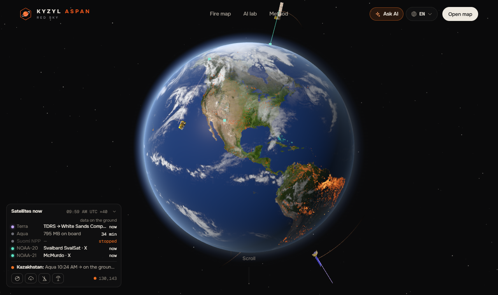

<h1 align="center">Raul Ni</h1>

  <b>Full-stack engineer · Applied AI · Robotics</b> 
  Kazakhstan · open to freelance and remote work

  
  
  

I build products end to end: the interface, the API and the data behind it, and when the task needs it, the model or
the device on the other side. I care about evidence, so the projects below come with benchmarks, statistical tests and
live demos rather than adjectives.

Привет! Я Рауль, разработчик из Казахстана: fullstack, AI и робототехника. Открыт к фрилансу.

<table>
<tr>
<td width="33%" valign="top"><b>Web products</b> React and Next.js frontends, APIs on Node.js and FastAPI, PostgreSQL and Supabase, auth, deploys.</td>
<td width="33%" valign="top"><b>Applied AI</b> LLM features in real products, speech recognition and synthesis, GPU training optimization.</td>
<td width="33%" valign="top"><b>Hardware</b> ESP32, Arduino and Raspberry Pi: sensors, firmware, devices that talk to a phone or a laptop.</td>
</tr>
</table>

## Selected projects

<table>
<tr>
<td width="50%" valign="top">

### Kyzyl Aspan
NASA Space Apps Challenge 2026. 26 years of NASA wildfire detections from two satellite generations, MODIS and VIIRS,
merged into one consistent record for Kazakhstan, with a fire-risk model on top.

**Result:** the 2012 sensor jump shrinks from ×3.26 to ×1.09; risk model ROC-AUC 0.931 vs 0.890 baseline.

</td>
<td width="50%" valign="top">

### chessbot
A chess engine written from scratch in Rust: move generator, search, NNUE neural evaluation and its own trainer,
no third-party libraries. Every change had to pass an SPRT match before it went in. Plays on Lichess as a bot.

**Result:** the current build beat the first working version 199–0 with one draw.

</td>
</tr>
<tr>
<td width="50%" valign="top">

### Soup Kernel Challenge
Decentrathon 6.0, team DoStar, my role: software engineer. Custom Triton kernels for LoRA fine-tuning of
Qwen2.5-1.5B on a free Kaggle T4.

**Result:** 1.4× faster training and 5.8× less peak GPU memory, same model quality, 10/10 jury checks.

</td>
<td width="50%" valign="top">

### PhoneBox × Tsuki
An old Redmi A5 turned into a dedicated laptop remote: trackpad, keys, live screen and system stats, plus an
animated character drawn entirely in SVG code who reacts to touch and remembers you between days.

**Stack:** vanilla JavaScript and SVG on the phone, a Python server, a C# screen streamer.

</td>
</tr>
<tr>
<td width="50%" valign="top">

### J.A.R.V.I.S.
A voice assistant for Windows: call it by name and talk. It runs the laptop, looks at the screen, writes in Telegram
and takes commands from a phone. Speech recognition and synthesis run offline.

**Stack:** Vosk and Piper for offline speech, an LLM through Groq, Telegram Bot API.

</td>
<td width="50%" valign="top">

### BusBagala
Anonymous feedback on bus trips in Kazakhstan. Riders pick 1–5 tags out of 49 in Kazakh, Russian or English instead
of free text, so reviews stay concrete; moderation and private photo storage included.

**Stack:** Next.js, TypeScript, Supabase (Postgres, Auth, Storage).

</td>
</tr>
<tr>
<td width="50%" valign="top">

### UniRoute
LOCUS Startup Hackathon 2026, team project. An admissions navigator that turns grades, tests and budget into a list of
universities that fit, the points still missing and a plan with deadlines.

</td>
<td width="50%" valign="top">

### Robotics
Away from the browser and the GPU I build robots and small devices on ESP32, Arduino and Raspberry Pi: wiring up
sensors, writing firmware, getting a board to talk to a phone or a laptop.

</td>
</tr>
</table>

## Toolbox

   
  

## Hackathons

| Event | Project | Role |
|---|---|---|
| NASA Space Apps Challenge 2026 | [Kyzyl Aspan](https://github.com/Raul12-bit/kyzyl-aspan) | team project |
| Decentrathon 6.0 | [Soup Kernel Challenge](https://github.com/Raul12-bit/decentrahon6.0) | software engineer, team DoStar |
| LOCUS Startup Hackathon 2026 | [UniRoute](https://github.com/magasigmaff39/uniroute) | team DoStar |

---

Photos from <a href="https://unsplash.com">Unsplash</a> under the Unsplash License:
<a href="https://unsplash.com/photos/Q1p7bh3SHj8">NASA</a>,
<a href="https://unsplash.com/photos/7SjEuEF06Zw">Hassan Pasha</a>,
<a href="https://unsplash.com/photos/pfR18JNEMv8">Vishnu Mohanan</a>,
<a href="https://unsplash.com/photos/ekHSHvgr27k">Bogomil Mihaylov</a>,
<a href="https://unsplash.com/photos/0PNVrbI7bZM">Val Vesa</a>,
<a href="https://unsplash.com/photos/l74VaCZon7I">Marília Castelli</a>.
Project screenshots are taken from the live apps.
