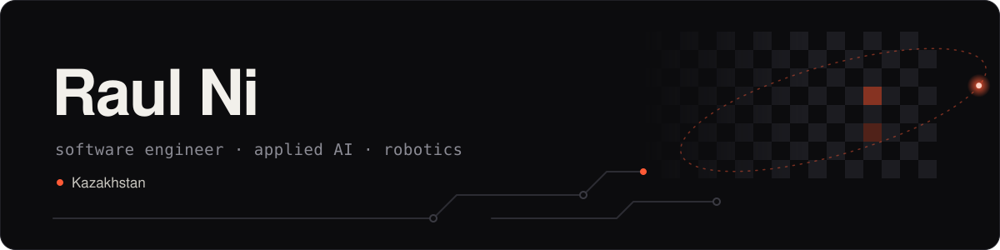
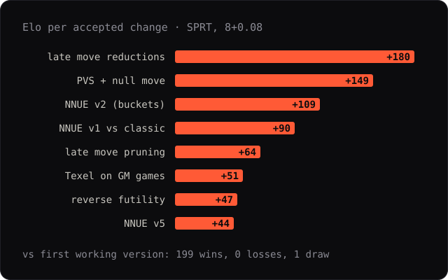
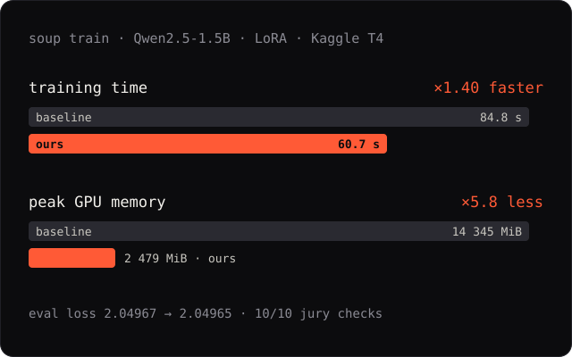
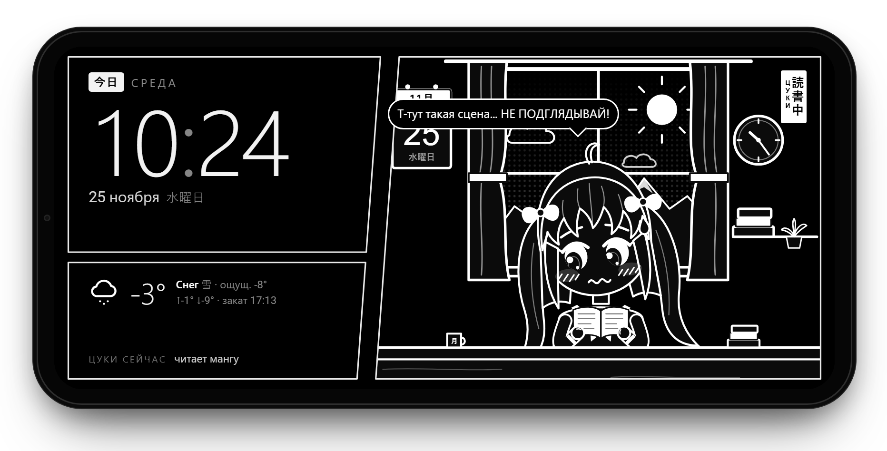
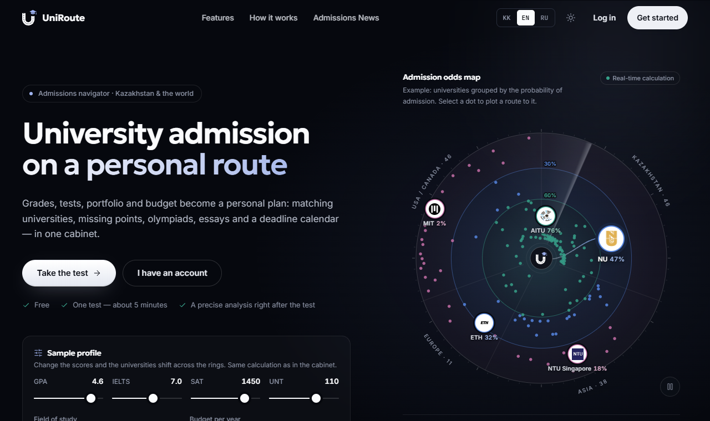

Hi, I'm Raul, a developer from Kazakhstan. I write full-stack apps and applied AI, and I'm into robotics.
What I enjoy most is the point where code meets the real world: satellite data, a GPU, a chessboard,
an old phone on my desk.

I like knowing whether a thing actually works, so most projects below come with a number attached.

Привет! Я Рауль, разработчик из Казахстана: fullstack, AI и робототехника. Ниже — мои проекты.

## Projects

<table>
<tr>
<td width="50%" valign="top">

**[Kyzyl Aspan](https://github.com/Raul12-bit/kyzyl-aspan)** · NASA Space Apps Challenge 2026

"Kyzyl aspan" is Kazakh for "red sky". Our Space Apps project stitches 26 years of NASA fire detections from two
generations of satellites, MODIS and VIIRS, into one consistent record for Kazakhstan. When VIIRS came online in 2012
the raw counts jump ×3.26; after harmonization the jump is ×1.09. On top of that sits a 1–4 week fire-risk model:
ROC-AUC 0.931 against 0.890 for climatology.

[Live demo](https://kyzyl-aspan.vercel.app) · TypeScript, React, Three.js, Python, FastAPI, Supabase

</td>
<td width="50%" valign="top">

**[chessbot](https://github.com/Raul12-bit/chessbot)** · Rust

A chess engine written from zero: move generator, search, a neural network evaluation (NNUE) and the trainer for
it, without a single library. Every change had to win an SPRT match against the previous version before it went in.
The current build beat the first working one 199 to 0, with one draw. It plays on Lichess as a bot.

Rust · NNUE · UCI

</td>
</tr>
<tr>
<td width="50%" valign="top">

**[Soup Kernel Challenge](https://github.com/Raul12-bit/decentrahon6.0)** · Decentrathon 6.0

Our team rewrote the hot parts of LoRA fine-tuning for Qwen2.5-1.5B as our own Triton kernels, on a free Kaggle T4.
Same model quality, 1.4× faster, 5.8× less GPU memory. Team DoStar; I was the software engineer.

Python · PyTorch · Triton

</td>
<td width="50%" valign="top">

**[PhoneBox × Tsuki](https://github.com/Raul12-bit/phonebox-tsuki)**

My old Redmi A5 sits next to the laptop as a remote: trackpad, keys, the live screen, system stats. Along the way
it got a resident. Tsuki is a grumpy manga girl drawn entirely in SVG code; she reacts to where you touch her,
remembers you between days and goes to sleep at 8 pm.

JavaScript · SVG · Python · C#

</td>
</tr>
<tr>
<td width="50%" valign="top">

**[UniRoute](https://github.com/magasigmaff39/uniroute)** · LOCUS Startup Hackathon 2026

A team project: an admissions navigator that turns grades, tests and budget into a list of universities that fit,
the points you're missing and a plan with deadlines.

[Live demo](https://university-route-741a.web.app) · React · TypeScript · Firebase · Gemini

</td>
<td width="50%" valign="top">

**[J.A.R.V.I.S.](https://github.com/Raul12-bit/jarvis)**

A voice assistant for Windows that I call by name. It runs the laptop, looks at the screen, writes in Telegram and
takes orders from my phone. Speech recognition and the voice itself work offline.

Python · Vosk · Piper · Groq

 

**[BusBagala](https://github.com/Raul12-bit/busbagala)**

Anonymous reviews of bus trips in Kazakhstan. Instead of free text, riders pick 1 to 5 tags out of 49, in Kazakh,
Russian or English, so every review says something concrete.

Next.js · TypeScript · Supabase

</td>
</tr>
</table>

## Robotics

Away from the browser and the GPU I build robots and small devices on ESP32, Arduino and Raspberry Pi: wiring up
sensors, writing firmware, getting a board to talk to a phone or a laptop. It's the part of engineering where a bug
doesn't throw an exception, the thing just drives into the wall.

## Stack

**Languages** TypeScript, Python, Rust, C/C++, C# 
**Web** React, Next.js, Node.js, FastAPI 
**AI** PyTorch, Triton, LLM APIs, speech recognition and synthesis 
**Hardware** ESP32, Arduino, Raspberry Pi

**Hackathons** NASA Space Apps Challenge 2026 · Decentrathon 6.0 · LOCUS Startup Hackathon 2026
